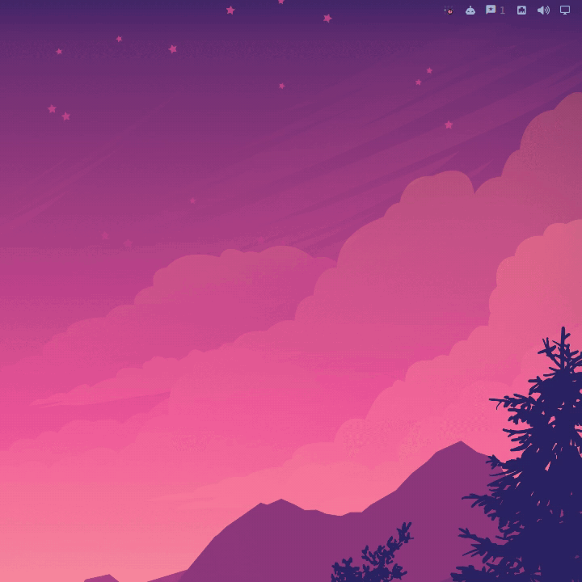

# mission-control

One place to see the state of all your coding-agent sessions (who is
working, who is **waiting on you**, who finished, who is stuck) and to answer
them without hunting for the right terminal tab.


The unit is the **workflow**, not the tool. Every agent session reports into
one daemon through a small per-tool adapter. The daemon tracks state, works
out whether an idle agent is *done*, *stuck* or *waiting for you*, and lets
you (or an orchestrating agent, over MCP) answer it.

## What it supports

| Source | How it connects | You can |
|---|---|---|
| **OpenCode** | Daemon reads OpenCode's own HTTP/SSE API. A tiny plugin gives a plain `opencode` an authenticated local port so every session is discovered automatically | See state, answer questions, approve or reject permissions, send follow-ups |
| **Claude Code** | A hooks-only Claude Code plugin pushes session events to the daemon | See state, questions and permission prompts (answer in the terminal; Claude Code has no input API) |

Ways to look at it:
- **CLI:** `status`, `show`, `answer`, `send`.
- **MCP server:** for an orchestrating agent.
- **Desktop UI:** a widget for [Omarchy](https://omarchy.org)'s shell, or a
  [GNOME Shell extension](ui/gnome/README.md). Both have an indicator, the
  workflow list, notifications, and a jump to the agent's terminal.



**Done vs stuck vs waiting** is decided by ordered, evidence-quoting rules
(no LLM). They read how the turn ended: errors, finish reason, a closing
question or an optional offer, "I couldn't…" blockers, open todos. A session
with no activity at all for 15 minutes is flagged as hung.

## Requirements

- Linux (discovery and liveness read `/proc`)
- Go 1.27+ to build (standard library only, no third-party modules)
- OpenCode and/or Claude Code

## Install

Download the binary for your machine from the
[latest release](https://github.com/rgolangh/agent-mission-control/releases/latest),
check it, and let it install itself:

```bash
curl -LO https://github.com/rgolangh/agent-mission-control/releases/latest/download/mission-control-linux-amd64
curl -LO https://github.com/rgolangh/agent-mission-control/releases/latest/download/SHA256SUMS
sha256sum --check --ignore-missing SHA256SUMS
chmod +x mission-control-linux-amd64
./mission-control-linux-amd64 install --dry-run   # see what it will do
./mission-control-linux-amd64 install
mission-control doctor
```

Or from source: `CGO_ENABLED=0 GOBIN=~/.local/bin go install -trimpath github.com/rgolangh/agent-mission-control/cmd/mission-control@latest`,
then `mission-control install`.

`install` puts in place, for your user only:
- the binary, in `~/.local/bin`;
- a systemd user service, which it starts;
- the OpenCode bridge plugin, if OpenCode is installed;
- the Claude Code hooks plugin, if Claude Code is installed;
- the desktop UI it detects: the omarchy-shell widget or the GNOME Shell extension.

It only adds files and never edits your existing configuration. It refuses to
overwrite anything it didn't write (unless `--force`) and leaves symlinks
alone. Commands that change another tool's settings, like enabling a shell
extension, are printed for you to run, or run with `--enable`. Use
`--only opencode,claude-code` to pick components. `mission-control uninstall`
removes exactly what was installed and unchanged.

## Use

```bash
mission-control status                 # every workflow
mission-control show <id>              # pending questions + history (<id>: ID column, any unique suffix)
mission-control answer <id> <choice>   # option label or number; for permissions: once | always | reject
mission-control send <id> <text...>    # follow-up message to a finished or stuck agent
```

MCP (e.g. Claude Code): `claude mcp add mission-control -- mission-control mcp`.
Tools: `list_workflows`, `get_workflow`, `answer_workflow`, `resolve_permission`
(`once` / `reject` only), `send_to_workflow`.

## Security

mission-control can approve agent permissions, which run commands as you, so
access is locked to your user:
- **Unix socket:** the CLI, hooks and MCP use a socket only your user can reach.
- **Token on TCP:** the widget's TCP port needs a per-start bearer token.
- **Bridge:** the OpenCode bridge needs a token and is protected against DNS rebinding.
- **Agent text is untrusted:** it's rendered as plain text, never passed to a shell, and labelled untrusted for MCP clients.

Read [SECURITY.md](SECURITY.md) before allow-listing MCP tools. The full
analysis is in [docs/threat-model.md](docs/threat-model.md).

## Status

Early and moving fast; interfaces may change. Tested against OpenCode 1.18
and Claude Code 2.1 on Linux. Planned: more adapters
(GitHub PRs, Jira) linked to the sessions that produced them, and a shared
web view.

Using it day to day? Share install friction, workflow misclassifications, and
which agent/desktop combinations you use in a
[field-feedback issue](https://github.com/rgolangh/agent-mission-control/issues/new).
Please don't attach raw agent transcripts or logs; they may contain secrets.

## Development

```bash
go vet ./... && go test -race ./...
QT_QPA_PLATFORM=offscreen qs -p ui/omarchy/test   # headless widget harness
```

## License

[Apache-2.0](LICENSE)
